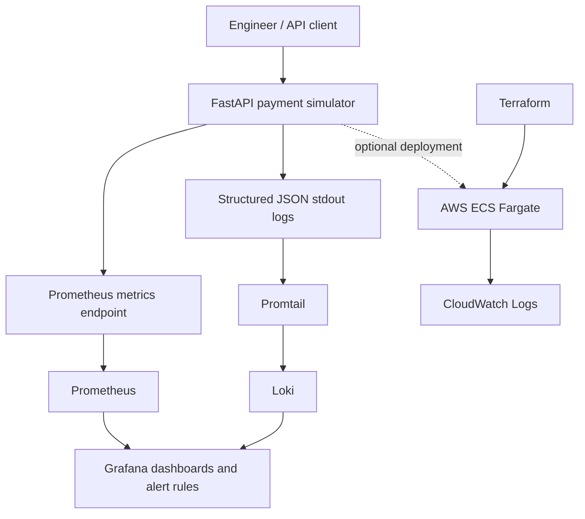

# PaymentPulse — Cloud-Native Payment Monitoring & Incident Response

PaymentPulse is an independent SRE portfolio project. It simulates cross-border payment lifecycle events and provides transaction lookup, structured logs, Prometheus metrics, Grafana dashboards, Loki log aggregation, alert rules, runbooks and an optional AWS ECS Fargate deployment using Terraform.

> This project uses synthetic data only. It is not TerraPay's platform, does not reproduce its confidential architecture, and must never contain company credentials, customer data, transaction IDs or internal endpoints.

## Architecture



## Local quick start

Prerequisites: Docker Engine/Desktop with Compose plugin, Git, and curl.

```bash
git clone <your-repository-url>
cd paymentpulse
docker compose up --build -d
docker compose ps
```

Open:
- API docs: http://localhost:8000/docs
- Health: http://localhost:8000/health
- Prometheus: http://localhost:9090
- Grafana: http://localhost:3000 (local demo login: `admin` / `change-me-local-only`)
- Loki readiness: http://localhost:3100/ready

Change the Grafana demo password before sharing the environment. Never expose this Compose stack to the public internet.

## Create and inspect synthetic transactions

```bash
curl -sS -X POST http://localhost:8000/payments \
  -H 'Content-Type: application/json' \
  -d '{"amount":125.75,"currency":"USD","destination":"IN"}'

# Copy transaction_id from the response
curl -sS http://localhost:8000/payments/PP-REPLACE_ME

# Simulate a decline, latency, or remittance callback failure
curl -sS -X POST http://localhost:8000/payments -H 'Content-Type: application/json' -d '{"amount":50,"simulate":"decline"}'
curl -sS -X POST http://localhost:8000/payments -H 'Content-Type: application/json' -d '{"amount":50,"simulate":"slow"}'
curl -sS -X POST http://localhost:8000/payments -H 'Content-Type: application/json' -d '{"amount":50,"simulate":"callback_failure"}'
```

Run `./scripts/smoke_test.sh` for a basic end-to-end API check. In Grafana Explore, select Loki and query `{container="paymentpulse-api"}`. In Prometheus, try `rate(paymentpulse_http_requests_total[5m])` and `histogram_quantile(0.95, sum by (le) (rate(paymentpulse_request_duration_seconds_bucket[5m])))`.

## Tests

```bash
python -m venv .venv
source .venv/bin/activate   # Windows PowerShell: .venv\\Scripts\\Activate.ps1
pip install -r app/requirements.txt
PYTHONPATH=. pytest -q
```

## AWS deployment (optional; costs money)

The Terraform example deploys a small Fargate service behind a public Application Load Balancer and sends container logs to CloudWatch Logs. It expects an existing VPC and at least two public subnets in different Availability Zones. This is intentionally separate from the local observability stack: the local Prometheus/Grafana/Loki stack is not automatically deployed to AWS by this Terraform module.

1. From the repository root, configure AWS CLI credentials for your sandbox role and run `AWS_REGION=ap-south-1 ./scripts/aws_ecr_push.sh`. The script creates the ECR repository if missing, enables scan-on-push, builds the API image and pushes it.
2. Copy `terraform/terraform.tfvars.example` to `terraform/terraform.tfvars`; fill in the account-specific image URI, VPC and subnet IDs, and set `allowed_ingress_cidr` to your public IP as `/32`. Never commit the real tfvars file.
3. Run `terraform init`, `terraform fmt -check`, `terraform validate`, `terraform plan` and review the plan carefully.
4. Apply only when you understand the resources and estimated charges. The ALB, Fargate tasks, public IPv4 addresses, data transfer and CloudWatch Logs may incur charges.
5. Test the output URL and inspect ECS service events and CloudWatch logs.
6. Run `terraform destroy` when finished, and verify no billable resources remain. ECR images/repositories created outside this module need separate cleanup.

### Security and cost guardrails

- Use a sandbox AWS account, budgets/billing alerts and the smallest practical Fargate task size.
- Do not use root credentials. Use IAM Identity Center or a short-lived role with only the permissions needed for ECR, ECS, EC2 networking, IAM pass-role and CloudWatch Logs.
- The example task execution role uses the AWS-managed ECS task execution policy; review and scope permissions further for a production system.
- The demo ALB accepts HTTP for simplicity. Do not send secrets or real data; use HTTPS with a managed certificate before any real exposure.
- The demo has a public ALB and public subnets. Restrict ingress to your IP for personal testing where possible, and delete the environment immediately after use.
- Terraform state can contain infrastructure metadata. Keep it local and private for this demo; never commit state, credentials, tfvars or `.env` files.

## Reliability objectives to discuss (portfolio targets, not measured production SLOs)

- Availability target: 99.5% over a rolling 30-day window for the demo API.
- Latency target: p95 below 500 ms for normal synthetic requests.
- Error budget: 0.5% monthly unavailability equivalent; alert on sustained 5xx ratio above 5% as an operational signal, not as the SLO itself.
- Detection: Prometheus scrape interval 15 seconds; alert pending periods are configured in `monitoring/prometheus/alerts.yml`.

## Current scope and limitations

- Implemented: synthetic payment API, transaction IDs, lifecycle event records, failure/latency scenarios, JSON logs, Prometheus metrics, local Docker Compose observability, dashboard provisioning, alert rules, runbooks, CI workflow and optional ECS Terraform scaffold.
- Not implemented: durable database, authentication, real payment rails, distributed tracing, production-grade secrets management, autoscaling, HTTPS listener, AWS-hosted Grafana/Loki/Prometheus, or a tested cloud deployment.
- The API stores transactions in process memory; data is lost when the container restarts and is not shared across replicas. This is deliberate for a small demo and must be addressed before scaling.

## Suggested interview narrative

"I built PaymentPulse as a separate SRE portfolio project based on a common production-support problem: quickly correlating a payment transaction's lifecycle with service health and application logs. I implemented a synthetic FastAPI payment service, emitted structured transaction events and Prometheus metrics, centralized container logs with Loki, and provisioned Grafana dashboards and alert rules. I added incident runbooks and an optional Terraform path to ECS Fargate. The project let me practice observability, alert tuning, incident response and cloud infrastructure without using any employer data or claiming the demo was deployed at my employer."
